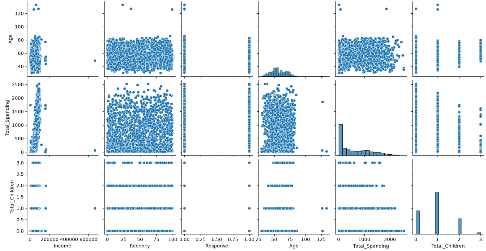
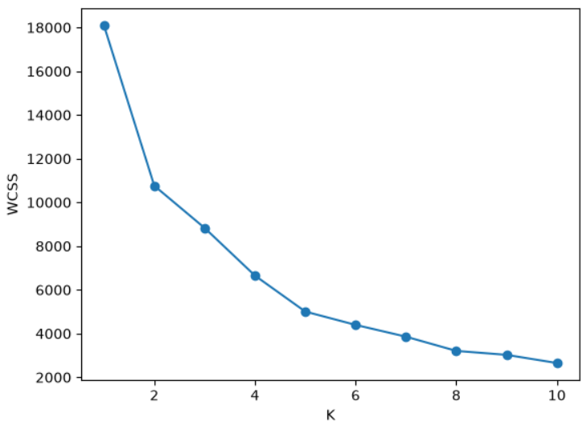
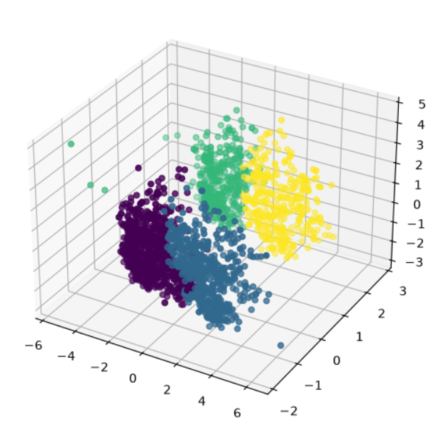
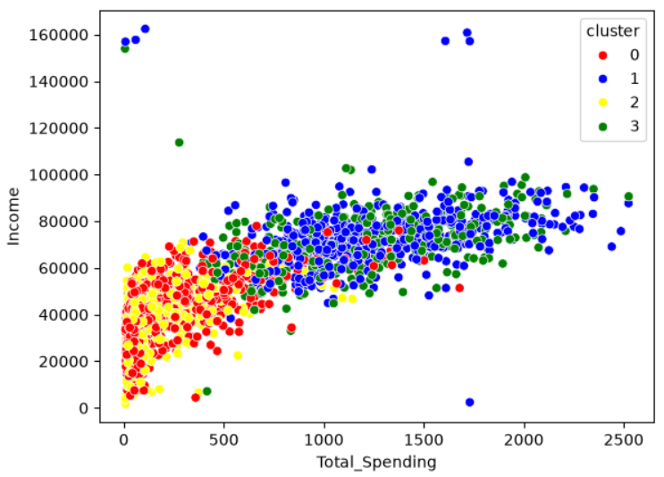

# SmartCart Customer Segmentation System

## Project Overview
SmartCart Customer Segmentation is a Machine Learning project that uses K-Means and Agglomerative Clustering to identify different customer groups based on their demographics, purchasing behaviour, and website activity.

The objective is to understand customer behaviour and help businesses develop targeted marketing strategies, improve customer engagement, and identify valuable customer segments.

## Problem Statement
The company uses generic marketing strategies for all customers without understanding their individual purchasing patterns. This project applies unsupervised machine learning to segment customers into meaningful groups.

## Dataset
- Total Records: 2,240 (2,236 after removing outliers)
- Total Features: 22 (15 after feature engineering and dropping columns)
- Domain: E-commerce / Customer Analytics
- Dataset: SmartCart Customer Dataset
- Missing values: 24 missing `Income` values filled with the median

## Technologies Used
- Python
- Pandas
- NumPy
- Matplotlib
- Seaborn
- Scikit-learn (StandardScaler, OneHotEncoder, PCA, KMeans, AgglomerativeClustering)
- Kneed (KneeLocator)

## Project Workflow
1. Data loading and understanding
2. Handling missing values (median imputation for `Income`)
3. Feature engineering: `Age`, `Customer_Tenure_Days`, `Total_Spending`, `Total_Children`, `Living_With`, grouped `Education`
4. Dropping redundant columns
5. Outlier removal (`Age` < 90, `Income` < 600,000): 4 records removed
6. Exploratory data analysis (pair plot, correlation heatmap)
7. One-hot encoding of categorical features
8. Feature scaling with StandardScaler
9. Dimensionality reduction with PCA (3 components, about 45% of variance retained)
10. Finding the optimal number of clusters (Elbow Method and Silhouette Score)
11. K-Means and Agglomerative clustering (k = 4)
12. Cluster profiling and analysis

## Visualizations

### 1. Exploratory Data Analysis

### 2. Elbow Method

### 3. Customer Clusters

### 4. Cluster Analysis

## Model
- Algorithms: K-Means and Agglomerative Clustering (Ward linkage)
- Features were one-hot encoded, scaled with StandardScaler, and reduced to 3 PCA components
- Number of clusters: 4, selected using the Elbow Method (KneeLocator: k = 4)
- Evaluation: Silhouette Score of about 0.36 for K-Means at k = 4. Scores rise to about 0.40 for k = 5 to 10, so k = 4 was chosen mainly from the elbow
- Final customer segments were profiled using the Agglomerative Clustering labels

## Key Insights
- **Two high-value clusters (1 and 3):** average income of about $70-73K and average total spending of about 1,190-1,240, with fewer children (about 0.5 per household). They buy far more through catalogs and stores and visit the website less (about 3.6-3.7 visits per month).
- **Two low-value clusters (0 and 2):** average income of about $37-40K and average total spending of only about 165-220, with more children (about 1.25 per household). They visit the website more often (about 6.3-6.7 visits per month).
- **Campaign response:** cluster 3 has the highest response rate (about 32%), compared with about 17% for cluster 1, so it is the strongest target for campaigns.
- **Living situation:** clusters 0 and 1 are customers living with a partner, while clusters 2 and 3 are customers living alone.
- **Business use:** the high-spending clusters suit premium offers and loyalty programmes, while the low-spending, web-heavy clusters suit discounts and web-based promotions.

## Conclusion
This project demonstrates the application of unsupervised machine learning for customer segmentation and business analytics.

## Author
Vineet Kumar

GitHub: https://github.com/Vineet4265

LinkedIn: https://www.linkedin.com/in/vineet-kumar-b08a90239/